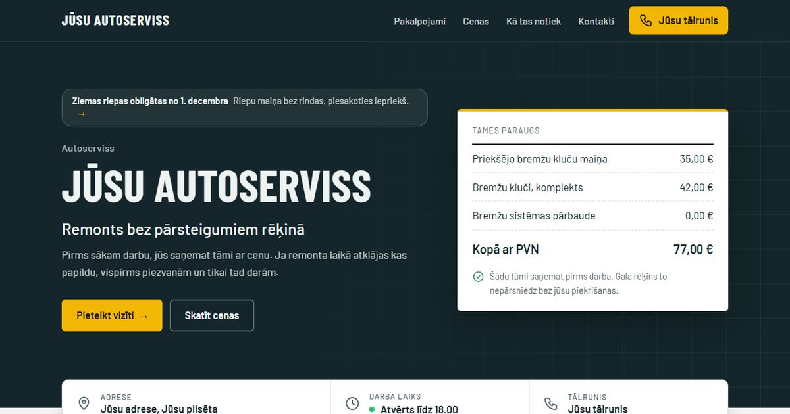
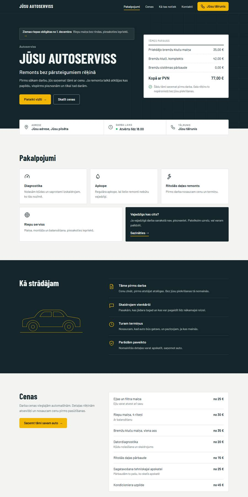
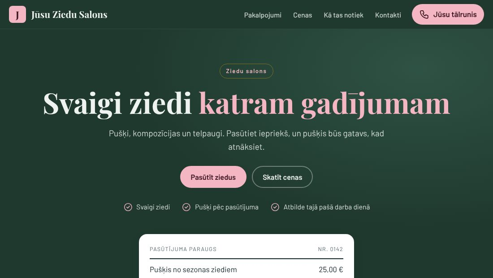
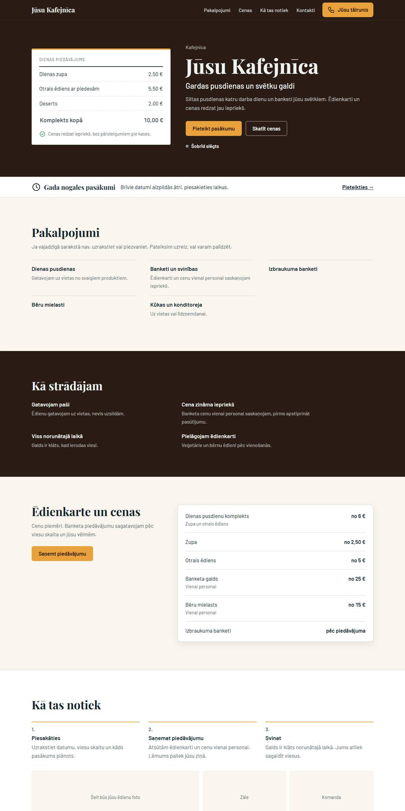
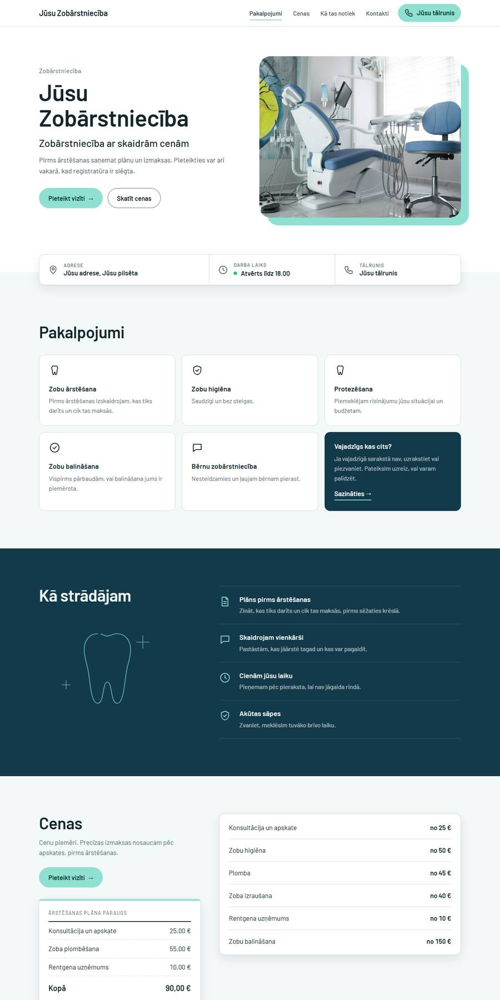
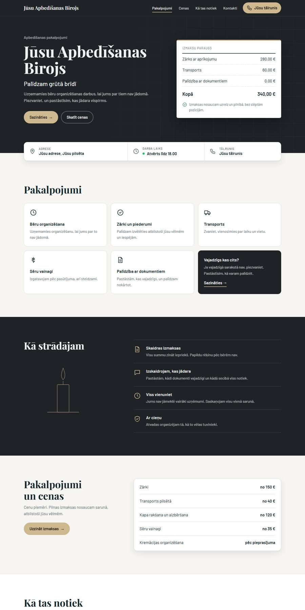
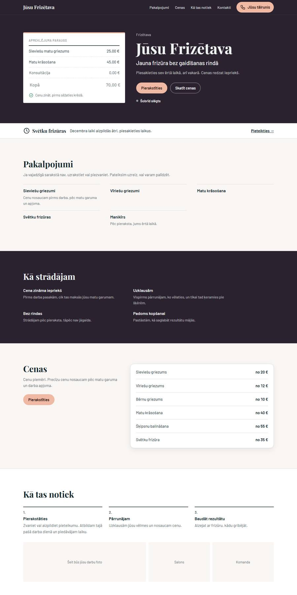
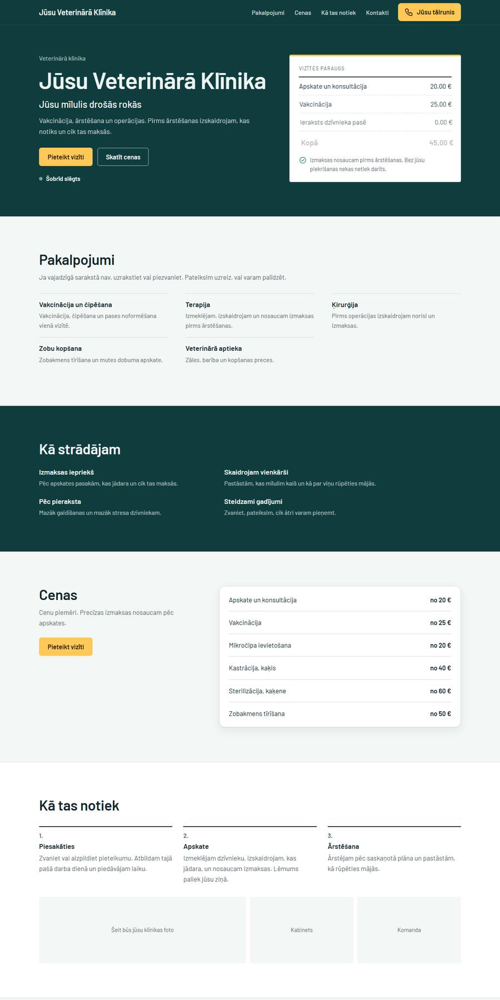
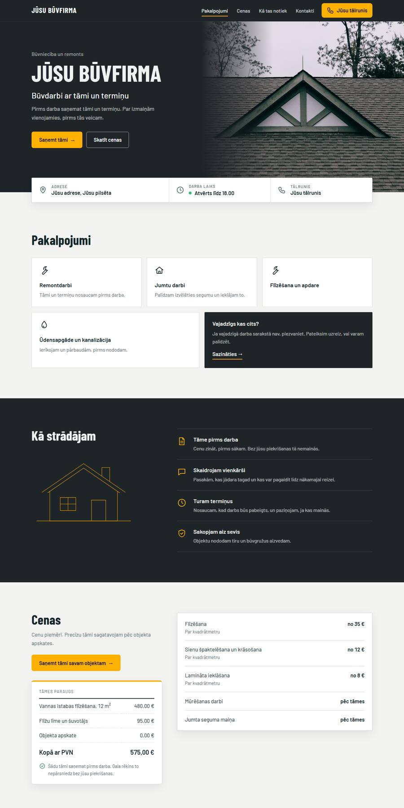
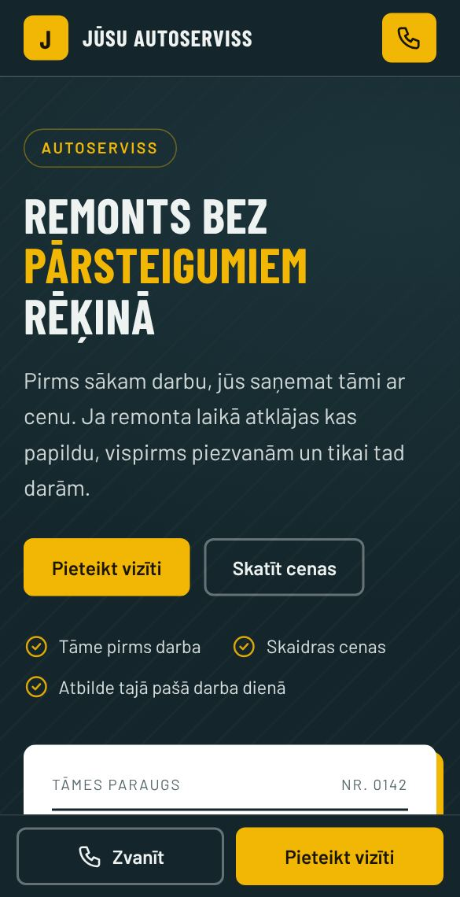

# Mājaslapas vietējiem uzņēmumiem

**Raivo Harkovs**

Vienkāršas, ātras mājaslapas mazajiem uzņēmumiem Latvijā. 
Paraugu saņemat pirms maksāšanas, tāpēc redzat rezultātu, nevis solījumus.

### [Atvērt mājaslapu →](https://xanfiend.github.io/website-demos/)

 

 

## Paraugi

Katrai nozarei ir savs izskats, teksti un cenrādis. Spiediet uz attēla, lai atvērtu paraugu.

<table>
<tr><td align="center" width="33%"><a href="https://xanfiend.github.io/website-demos/autoserviss/"> <b>Autoserviss</b></a></td><td align="center" width="33%"><a href="https://xanfiend.github.io/website-demos/ziedu-salons/"> <b>Ziedu salons</b></a></td><td align="center" width="33%"><a href="https://xanfiend.github.io/website-demos/kafejnica/"> <b>Kafejnīca</b></a></td></tr>
<tr><td align="center" width="33%"><a href="https://xanfiend.github.io/website-demos/zobarstnieciba/"> <b>Zobārstniecība</b></a></td><td align="center" width="33%"><a href="https://xanfiend.github.io/website-demos/apbedisanas-birojs/"> <b>Apbedīšanas birojs</b></a></td><td align="center" width="33%"><a href="https://xanfiend.github.io/website-demos/frizetava/"> <b>Frizētava</b></a></td></tr>
<tr><td align="center" width="33%"><a href="https://xanfiend.github.io/website-demos/veterinara-klinika/"> <b>Veterinārā klīnika</b></a></td><td align="center" width="33%"><a href="https://xanfiend.github.io/website-demos/buvfirma/"> <b>Būvniecība un remonts</b></a></td><td></td></tr>
</table>

Ja saņēmāt no manis e-pastu, tajā ir saite uz paraugu, kas sagatavots tieši jūsu uzņēmumam. To redz tikai tie, kam ir saite.

## Jūs atrod Google

Kad salūst auto, cilvēks telefonā ieraksta “autoserviss” un savu pilsētu. Katrs paraugs ir pielāgots tam, ko jūs darāt. Lapa ir veidota tā, lai meklētājs saprot, kas jūs esat un kur atrodaties, un lai potenciālie klienti jūs var ieraudzīt:

- virsrakstā un aprakstā ir jūsu pakalpojums un pilsēta, tieši tā, kā cilvēki meklē
- nosaukums, atrašanās vieta un pakalpojumi ir pierakstīti arī meklētājam saprotamā formātā
- lapa ātri atveras un labi izskatās telefonā, un Google to ņem vērā
- pēc nodošanas piesaku lapu Google, lai tā parādās meklēšanā
- palīdzu izveidot vai sakārtot Google uzņēmuma profilu, lai jūs parādāties arī Google Maps ar adresi, darba laiku un tālruni

Vietu Google rezultātos neviens godīgi apsolīt nevar. Bet bez mājaslapas jūs tur nav vispār.

> Paraugu lapas Google nerāda. Tās redz tikai tie, kam ir saite. Meklēšanā parādīsies jūsu īstā lapa.

> **Līdz 2026. gada 31. decembrim:** lapa bez maksas, ja pēc tam atļaujat publicēt jūsu godīgu atsauksmi.

## Kā tas notiek

| 1. Apskatāt paraugu | 2. Pasakāt, ko mainīt | 3. Maksājat, kad patīk |
|:--|:--|:--|
| Bez maksas un bez saistībām. Ja nepatīk, vienkārši neatbildiet. | Atrakstiet e-pastā, un ielieku jūsu cenas, foto, darba laiku un kontaktus. | Cena no 50 €, zināma iepriekš. Maksājat tikai par gatavu lapu. |

## Arī telefonā

Lielākā daļa klientu jūs meklēs telefonā, tāpēc katra lapa ir veidota vispirms tam:

- ātri atveras arī ar lēnu internetu
- Google PageSpeed (Lighthouse) testā telefona režīmā: ātrdarbība 96 no 100 (2026. gada 11. novembris, [pārbaudiet paši](https://pagespeed.web.dev/analysis?url=https%3A%2F%2Fxanfiend.github.io%2Fwebsite-demos%2F))
- zvanīšanas un pieteikšanās pogas vienmēr pie rokas
- cenas un darba laiks redzami bez meklēšanas
- pieteikuma forma nonāk jūsu e-pastā

 

---

Interesē? Atbildiet uz e-pastu, ko jums nosūtīju, un uzrakstiet, kas paraugā jāmaina. Cena no 50 €.

